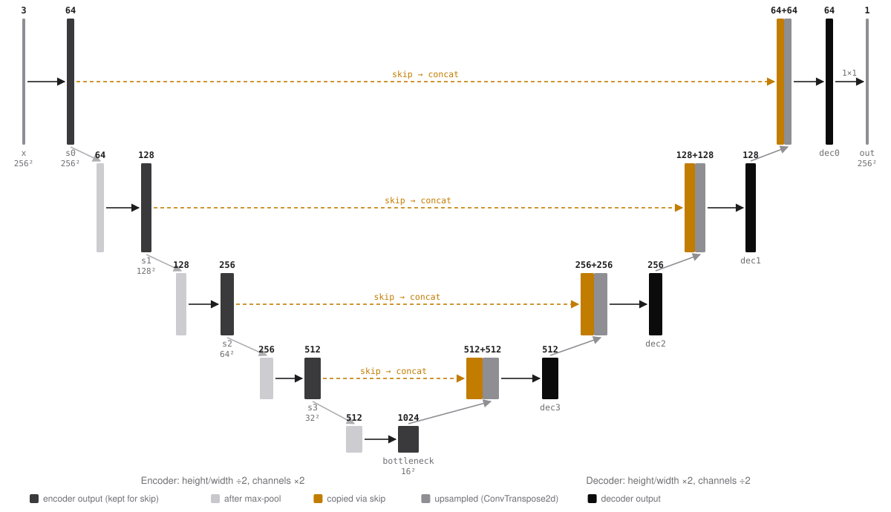
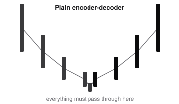
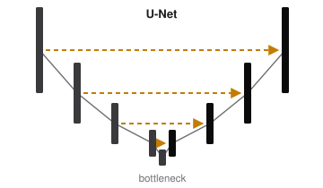

In my [previous post](/writing/encoder-decoder-architecture/) I argued that the shortcut between encoder and decoder is the most important improvement in the history of the encoder-decoder. In my computer vision course project, I built both versions for medical image segmentation, so here is what that difference looks like in real code.

The task: given an image, predict a mask with one value per pixel. I use two datasets:

- **PH2**: dermoscopy images of skin lesions. The target is one large, blob-shaped region.
- **DRIVE**: retina images. The target is the blood vessels, many of them only a few pixels wide.

## The U-Net, level by level

*Click the diagram to open it full size.*

Each bar is a feature map. Its **height** stands for spatial size (shorter = smaller) and its **width** for the number of channels (wider = more). The numbers are the real shapes for a 256×256 input with `base = 64`.

- **Going down (encoder):** at every level, a `DoubleConv` (two 3×3 convolutions) changes the channels, then max-pooling halves the height and width. Channels double each level: 64 → 128 → 256 → 512 → 1024.
- **Bottom (bottleneck):** 16×16 with 1024 channels, the most compressed point.
- **Going up (decoder):** a `ConvTranspose2d` doubles the height and width and halves the channels. Then the encoder's feature map from the same level is **concatenated** onto it (the orange bars), and another `DoubleConv` mixes them.
- **Output:** a 1×1 convolution turns 64 channels into a single-channel mask.

Because the input is halved four times, the image size has to be divisible by 2⁴ = 16.

## What the plain encoder-decoder looks like

Both models have the same hourglass shape: shrink, then expand. The difference is whether information has a side path.

  
  

In the plain encoder-decoder, everything has to pass through the 16×16 bottleneck. A vessel that is two pixels wide in the input may already be gone by then, and the decoder has no way to get it back.

In the U-Net, each decoder level receives two things at once: *what* is there (from the bottleneck path below) and *where* exactly it is (from the encoder on the left, at full resolution for that level).

## The two models in code

| | Encoder-decoder (baseline) | U-Net |
|---|---|---|
| Skip connections | none | 4, joined with `torch.cat` |
| Convolutions per level | 1 | 2 (`DoubleConv`) |
| Channels | constant `base` (32) | doubles each level: 64 → 1024 |
| Upsampling | `nn.Upsample` (copies pixels, nothing learned) | `ConvTranspose2d` (learned, also halves channels) |
| Output layer | 3×3 conv → 1 channel | 1×1 conv → 1 channel |
| Parameters | 65,921 | 31,031,745 (`base` 64) · 7,760,097 (`base` 32) |
| Input size | divisible by 16 | divisible by 16 |

## What I expect, and a caveat

The models haven't been trained yet, so I don't have Dice or IoU numbers. I'll add them here once both have run on the cluster.

My expectation: **U-Net will be better on both datasets, with a bigger gap on DRIVE.** A skin lesion in PH2 is one large region, so even without skip connections the decoder can roughly recover its outline. Retinal vessels are only a few pixels wide, so they depend most on the fine detail that skip connections carry back.

The caveat matters, though. With `base = 64`, the U-Net has about **470 times** as many parameters as the baseline. If it wins, part of the improvement comes from skip connections, and part simply comes from being a much bigger model. To isolate the effect of the skip connections, the fair comparison is a third model: the same U-Net with the skip connections removed.
